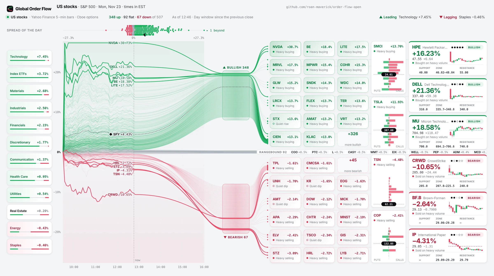
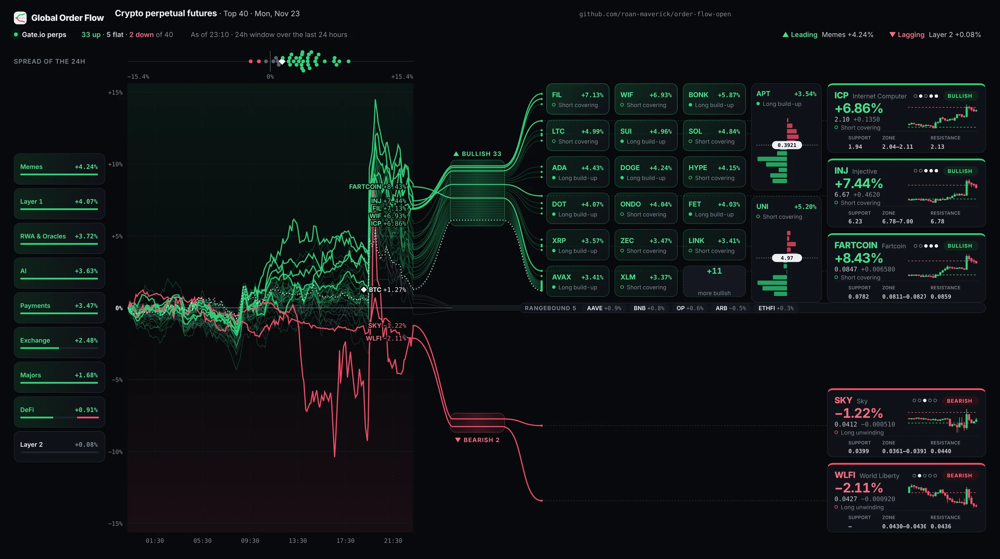
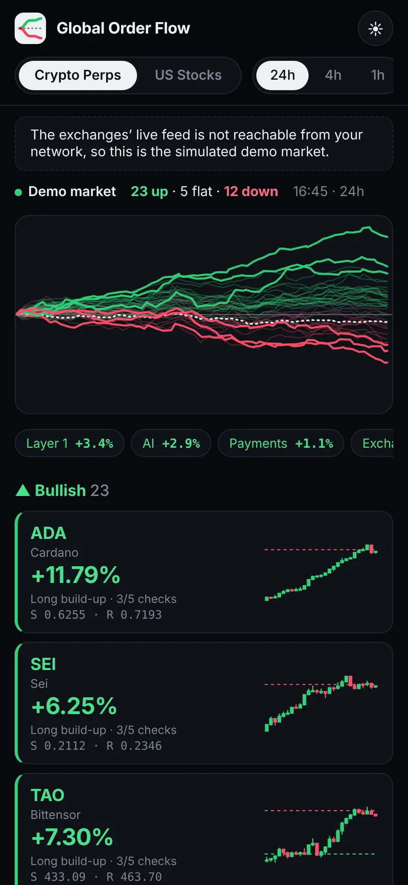
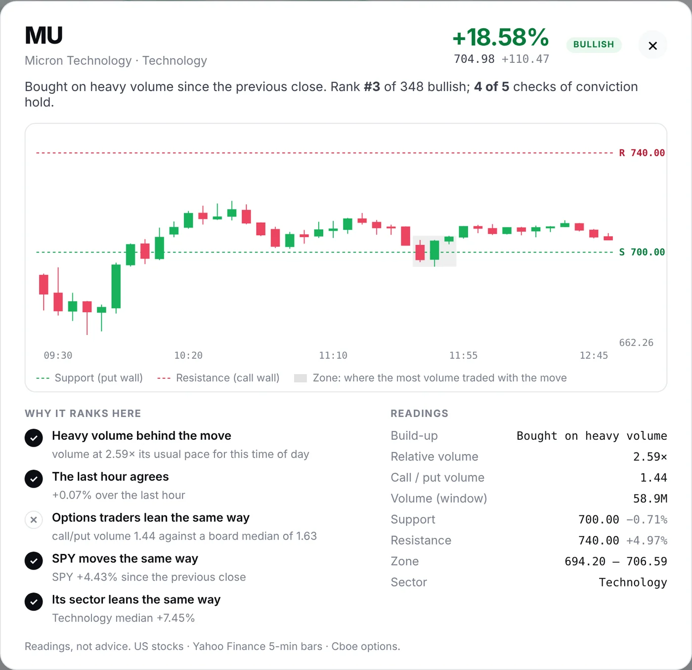

<div align="center">


# Global Order Flow

### See where the money is flowing across the whole S&P 500 and crypto, live, on one screen.

Every stock rises above the zero line or falls below it, and runs on its own path to a card.<br>
You see the whole market at once, and for each name whether real money is behind the move.

**Free · open source (MIT) · runs on your own computer · no API keys · no sign-up**

[](https://github.com/roan-maverick/Order-Flow-Board/actions/workflows/ci.yml)

[Quick start](#quick-start) · [How to read it](#how-to-read-the-board) · [Use it with AI](#use-it-with-ai) · [Build an AI trading system](#build-your-own-ai-trading-system) · [API](#the-json-api) · [FAQ](#faq)

</div>

<br>



<table>
  <tr>
    <td width="66%"></td>
    <td width="34%"></td>
  </tr>
</table>

<sub>Screenshots from real sessions on 23 November 2026: US stocks mid-session, crypto perpetuals from Gate.io.</sub>

## What it is

A **live dashboard** for two markets:

- **US stocks:** all **503 S&P 500 companies**, plus SPY, QQQ, DIA, IWM and popular names outside the index (MSTR, TSM, ARM, SOFI…). Switch between the **Top 50**, **Top 100** (the most-traded today), the **S&P 500**, or **All**.
- **Crypto:** the **most-traded perpetual futures** (BTC, ETH, SOL, XRP, DOGE…), the **Top 20, 40 or 80**, read live from the exchanges, 24/7.

For every name it shows:

| | What it tells you |
|---|---|
| **Direction** | Up, down or flat over the window (the day, the last hour, the last 15 minutes…) |
| **Build-up** | Is real money behind the move? New positions or heavy volume, or just a quiet drift? |
| **5 conviction checks** | Does the rest of the picture agree: volume, the shorter window, options or aggressive buyers, the market, the sector? |
| **Support & resistance** | From the biggest option positions (put wall / call wall) or the price levels where the most trading happened |
| **Sectors** | Which sectors lead and which lag, and how many names in each are up or down |

Then it gives all of that to you **as data**: copy it into any AI chat with one click, connect it to **Claude** so you can ask questions in plain English, or read it from your own scripts and bots.

## Quick start

You need **Node.js 22 or newer** ([download it here](https://nodejs.org), pick "LTS"). Check with `node -v`.

```bash
git clone https://github.com/roan-maverick/Order-Flow-Board.git
cd Order-Flow-Board
npm install
npm start
```

Then open **http://localhost:5199** in your browser.

- **First start:** the board is ready in about 20 seconds (the S&P 500 loads with a progress bar). After that it opens instantly, because the last session is saved on your computer.
- **No git?** Click the green **Code** button on GitHub → **Download ZIP**, unzip it, open a terminal in that folder, then run `npm install` and `npm start`.
- **Just want to look?** `npm run demo` runs the board on a **simulated market** (made-up prices, no internet needed).
- **Stop it** with `Ctrl + C` in the terminal.

Works on Windows, macOS and Linux.

## How to read the board



| Part | What it shows |
|---|---|
| **Top bar** | Pick the market (US Stocks / Crypto), the time window, and the list (Top 50 / Top 100 / S&P 500 / All). Search any ticker with the search box (or press `/`). |
| **Status bar** | Whether the US market is open, which session you're seeing, and when the data last updated. On weekends it shows the last session. |
| **Spread strip** | Every name as a dot, placed by its move: the shape of the market at a glance. The diamond is the benchmark (SPY for stocks, BTC for crypto). |
| **Sectors** (left) | Each sector's middle move, the best on top. The thin bar under each shows how many of its names are up (green), flat (grey) or down (red). Hover a sector to light up its names. |
| **Chart** | Each name's move through the window, starting from 0%. The five biggest movers on each side are bold and labelled; the dotted line is the benchmark. |
| **Tunnels** | All rising lines squeeze through the green tunnel, all falling ones through the red, then fan out to their tiles. |
| **Middle bar** | Names that barely moved ("rangebound") end here. |
| **Tiles** | One per name, ordered by the size of the move. Deeper colour = bigger move. A **filled dot** means new money is behind the move; a **hollow dot** means a quiet move (positions closing, or light volume). |
| **Tall tiles** | The next-strongest names, with option positions (or traded volume) at each price around the current price. |
| **Big cards** | The **strongest** readings on each side: move, build-up, conviction dots, support, zone and resistance, and candles. |
| **Click anything** | Opens the full reading: candles with support and resistance lines, the zone, every check with its reason, and the numbers. |

### Build-up: is real money behind the move?

**Crypto** compares price with **open interest** (how many futures positions are open):

| Price | Open interest | Build-up | In plain words |
|---|---|---|---|
| ↑ | ↑ | **Long build-up** | New buyers are opening positions |
| ↑ | ↓ | **Short covering** | Price rises because sellers are closing out |
| ↓ | ↑ | **Short build-up** | New sellers are opening positions |
| ↓ | ↓ | **Long unwinding** | Price falls because buyers are closing out |

**US stocks** have no futures per stock, so the board compares the move with **relative volume**: today's volume against what this stock usually trades by this time of day.

| Move | Volume | Build-up |
|---|---|---|
| ↑ | Heavier than usual | **Bought on heavy volume** |
| ↑ | Lighter than usual | **Rising on light volume** |
| ↓ | Heavier than usual | **Sold on heavy volume** |
| ↓ | Lighter than usual | **Falling on light volume** |

### The five conviction checks

Each card shows five dots (filled = holds, hollow = doesn't, grey = can't be measured):

1. **Participation:** new positions opened (crypto), or volume above its usual pace (stocks)
2. **The shorter window agrees:** for example, the last hour points the same way as the day
3. **Flow agrees:** aggressive buyers vs sellers (crypto), or call vs put option volume (stocks)
4. **The market agrees:** SPY or BTC moved the same way
5. **The sector agrees:** the name's sector leans the same way

The **big cards** go to the names with the best mix of a big move, strong participation and passed checks, so the biggest mover doesn't always get a card.

### Support, resistance and the zone

- **Option walls** (the 100 most-traded stocks, plus BTC and ETH): **support** is the strike with the most put options open below the price; **resistance** is the strike with the most call options open above it.
- **Volume shelves** (everything else): the price levels where the most trading happened over the last two sessions. An empty resistance just means the price is above everywhere it traded recently.
- **Zone:** the 15-minute stretch where the most new positions (crypto) or volume (stocks) came in while the price moved the name's way.

## Use it with AI

### 1. One click: "Copy for AI"

Press **Copy for AI** on the board. It copies a plain-text brief of the whole board (breadth, every sector, the strongest setups with their levels). Paste it into ChatGPT, Claude, Gemini or any AI chat, then ask, for example:

> Which sectors have the strongest buying today, and which names inside them have all five checks holding?

> Compare the strongest bullish and bearish setups. Which have the tightest distance to support or resistance?

> Explain this board to me like I'm new to trading.

More prompts are in [`examples/ai-prompts.md`](examples/ai-prompts.md).

### 2. Connect it to Claude (MCP)

The board includes an **MCP server**, the standard way to give AI assistants tools. Once connected, Claude can read the live board whenever you ask.

**Claude Desktop:** open **Settings → Developer → Edit Config** and add this (use the full path to *your* folder):

```json
{
  "mcpServers": {
    "global-order-flow": {
      "command": "node",
      "args": ["/full/path/to/Order-Flow-Board/server/mcp.mjs"]
    }
  }
}
```

On Windows, write the path with double backslashes: `"C:\\Users\\you\\Order-Flow-Board\\server\\mcp.mjs"`. Restart Claude Desktop.

**Claude Code:**

```bash
claude mcp add --transport stdio global-order-flow -- node /full/path/to/Order-Flow-Board/server/mcp.mjs
```

Keep the board running (`npm start`), then just ask:

> What is the S&P 500 doing right now? Which sectors lead?
> Find bullish stocks with heavy buying and at least 4 of 5 checks.
> Give me the full reading on NVDA. Where are its put and call walls?
> Which crypto perps show short build-up on the 4h window?

Claude gets four tools: `get_market_board`, `find_setups`, `get_symbol` and `get_status`. It works the same in any app that supports MCP (Cursor, Windsurf and others).

### 3. The terminal

```bash
npm run flow                                          # the US board brief
npm run flow -- crypto --window 4h
npm run flow -- us --side bullish --min-checks 4 --fresh   # filtered setups
npm run flow -- us --symbol AAPL                      # one name in full
```

## Build your own AI trading system

The board does the hard part (collecting the data and reading it) and hands you clean, structured readings. Here is a simple path from "looking" to "a system", one step at a time.

**Step 1: Ask.** Use **Copy for AI** or the **Claude connection** above. Ask why names rank where they do. Learn what a strong reading looks like before automating anything.

**Step 2: Write your rules down.** Turn what you learned into rules a computer can check, for example:
*"Long a stock when it's bought on heavy volume, 4+ checks hold, and it's within 3% of support. Stop just below support. Target twice the risk."*

**Step 3: Paper trade them.** The included bot does exactly that with **fake money**:

```bash
npm run paper-bot              # US stocks
npm run paper-bot -- crypto    # crypto
```

Every 5 minutes it asks the board for the strongest setups, opens paper trades (stop at support or resistance, target at 2× the risk), closes them at the stop, the target or the end of the session, and writes every trade to `paper-trades.csv`. Its rules are about 30 lines in [`examples/paper-bot.mjs`](examples/paper-bot.mjs). Change them and compare.

**Step 4: Measure.** Let it run for weeks across different market days (up days, down days, quiet days). Open `paper-trades.csv` in Excel or Google Sheets: win rate, average win vs average loss, worst losing streak. A rule that only works on one kind of day isn't a rule yet.

**Step 5: Let an AI help you improve it.** Give Claude (or any AI) the CSV and the board's readings, and ask what the losing trades had in common. With the MCP connection it can check the live board itself while it reasons.

**Step 6: Only then, think about real money.** Connect a broker's **paper account** first (most brokers and crypto exchanges offer one, e.g. Alpaca, Interactive Brokers, exchange testnets). Add hard limits: maximum risk per trade, maximum loss per day, and a kill switch. Start tiny.

> **This project never places real orders, on purpose.** It shows market data and readings, not investment advice. Markets are risky, past readings don't predict the future, and you are responsible for any trading you do.

### Read it from your own code

Every number on the board is available from the local API, in any language:

```python
import requests

board = requests.get("http://localhost:5199/api/flow/us",
                     params={"side": "bullish", "minChecks": 4, "fresh": "true", "limit": 10}).json()
for s in board["results"]:
    print(s["symbol"], s["changePct"], s["buildUp"]["label"], s["support"], s["resistance"])
```

```js
const board = await fetch('http://localhost:5199/api/flow/crypto?window=4h').then(r => r.json());
console.log(board.strongest.bullish.map(a => `${a.symbol} ${a.changePct}%`));
```

## The JSON API

While the board runs, these are open on `http://localhost:5199`:

| Endpoint | What you get |
|---|---|
| `GET /api/health` | What's loaded, if the US market is open, when it last refreshed |
| `GET /api/flow/us` | The whole board: breadth, sectors, every name with side, build-up, checks, levels |
| `GET /api/flow/crypto?window=4h&universe=top20` | Same for crypto, with a window and list |
| `GET /api/flow/us?side=bullish&minChecks=4&limit=10` | Filtered setups, strongest first |
| `GET /api/flow/us?format=text` | The plain-text brief (what **Copy for AI** copies) |
| `GET /api/flow/us/NVDA` | One name in full, with its 5-minute candles |
| `GET /api/market/us` | The raw market data the board is drawn from |

**Filters:** `window` (US: `day`, `1h`, `15m` · crypto: `24h`, `4h`, `1h`), `universe` (US: `top50`, `top100`, `sp500`, `all` · crypto: `top20`, `top40`, `top80`), `side` (`bullish`, `bearish`, `rangebound`), `minChecks` (0–5), `buildUp` (e.g. `LONG_BUILD,ACCUMULATION`), `fresh=true` (only moves with new money behind them), `sector`, `limit`. Add `&pretty` for readable JSON. `GET /api` lists everything.

## Where the data comes from

| | Source | How fresh |
|---|---|---|
| **S&P 500 list** | The open dataset at [datasets/s-and-p-500-companies](https://github.com/datasets/s-and-p-500-companies) (updated several times a month), with a copy built in for offline use | Read on every start |
| **US prices & volume** | Yahoo Finance 5-minute bars, regular hours | Every 3 minutes while the market is open (can be a few minutes behind) |
| **US option walls** | Cboe delayed option quotes, expiries in the next 35 days | About once a day per stock (open interest only changes overnight) |
| **Crypto** | **Binance**, or **Bybit** where Binance is blocked, or **Gate.io** where both are blocked (including the United States). It picks automatically. | Every minute |
| **BTC & ETH option walls** | Deribit | On load |

Everything is fetched **by your own computer**, from public sources, without keys. These are free, unofficial sources: perfect for a personal dashboard, but not a licensed real-time feed. Check each provider's terms before using the data commercially.

## Settings

Everything works out of the box. To change something, copy `flow.config.example.json` to `flow.config.json` and edit it:

| Setting | Default | What it does |
|---|---|---|
| `port` | `5199` | The address: http://localhost:5199 |
| `host` | `127.0.0.1` | Only your computer can open the board. Use `0.0.0.0` to open it to other devices on your network |
| `us.refreshMinutes` | `3` | Minutes between US refreshes while the market is open |
| `us.popular` | MSTR, TSM, ARM… | Extra US names outside the S&P 500 (the "All" list). Add your own |
| `us.optionsTop` | `100` | Option walls for this many of the most-traded stocks (chains are big: SPY's is ~6 MB) |
| `us.optionWalls` | `true` | `false` skips options entirely (volume shelves only) |
| `crypto.count` | `80` | How many perpetuals to load |
| `crypto.exchange` | `auto` | Or pin one: `binance`, `bybit`, `gate` |

Environment variables work too: `PORT=5200 npm start`, `FLOW_DEMO=1`, `FLOW_US=0` (crypto only), `FLOW_CRYPTO=0` (US only). The crypto coin list and sectors are in `src/data/universe.ts`.

## All commands

| Command | What it does |
|---|---|
| `npm start` | Build and start the board with live data |
| `npm run demo` | The board on a simulated market (no internet) |
| `npm run dev` | For developers: instant reload while you edit |
| `npm run flow` | Read the board in the terminal |
| `npm run mcp` | The MCP server for AI apps (normally started by the app itself) |
| `npm run paper-bot` | The paper-trading example (fake money) |
| `npm run update:sp500` | Refresh the built-in S&P 500 list |
| `npm test` | Run the tests |

## FAQ

**It says "simulated demo market".** Either you started it with `npm run demo`, or no live source answered. For crypto that means your network blocks all three exchanges. Check your internet connection or VPN. The status bar says which.

**Why does crypto say Gate.io and not Binance?** Binance and Bybit refuse connections from some countries (including the US). The board then moves on to Gate.io automatically. The readings work the same way.

**The US market is closed. What am I seeing?** The last full session. The status bar shows its date. It switches to the new session by itself at the next open.

**Is it real-time?** Close to it. Crypto updates every minute. US bars update every 3 minutes and can trail the market by a few minutes. Option data is delayed and changes once a day. Don't use it for split-second trading.

**Some stocks show no support or resistance.** Only the 100 most-traded stocks get option walls (raise `us.optionsTop` if you like). The rest use volume shelves, and a stock at its highs has no traded level above it yet.

**"Port 5199 is already in use".** Another copy is running, or another app uses that port. Close it, or pick another port: `PORT=5200 npm start` (Windows PowerShell: `$env:PORT=5200; npm start`).

**How much internet does it use?** The S&P 500 refresh is about 2 MB every 3 minutes while the market is open. Option walls are the big part: about 120 MB, roughly every 8 hours. To save data, lower `us.optionsTop` or set `us.optionWalls` to `false` in `flow.config.json`.

**Can I put it on a server for my community?** Yes: it runs anywhere Node.js runs. Set `host` to `0.0.0.0`. Mind the data sources' terms if you share it widely.

**Does it trade for me?** No. It reads the market and gives you the readings. The paper bot only uses fake money.

## Project layout

```
server/     the local server: S&P 500 engine, crypto engine, JSON API, MCP server
src/model/  the logic: sides, build-up, checks, levels, zones, sectors, AI brief
src/data/   crypto feeds, demo market, coin and sector lists, S&P 500 list
src/ui/     the board, detail panel, phone layout, search
examples/   paper-trading bot, AI prompts
scripts/    terminal tools
```

Contributions are welcome. See [CONTRIBUTING.md](CONTRIBUTING.md).

## Credits

The board idea (bulls above zero, bears below, tunnels to cards) and the reading method (build-up quadrants, the confirmation checks and the 45/35/20 strength mix) come from [Order Flow](https://github.com/MrChartist/order-flow) by Mr. Chartist, built for Indian F&O. This project is an independent implementation for global markets, written from scratch; it contains none of Order Flow's code.

## Disclaimer

Global Order Flow shows market data and readings for **information and education only**. It is **not investment advice**, it does not recommend buying or selling anything, and it can be wrong, late or incomplete. Trading involves risk of loss. You are responsible for your own decisions.

## License

[MIT](LICENSE): free to use, change and share.
