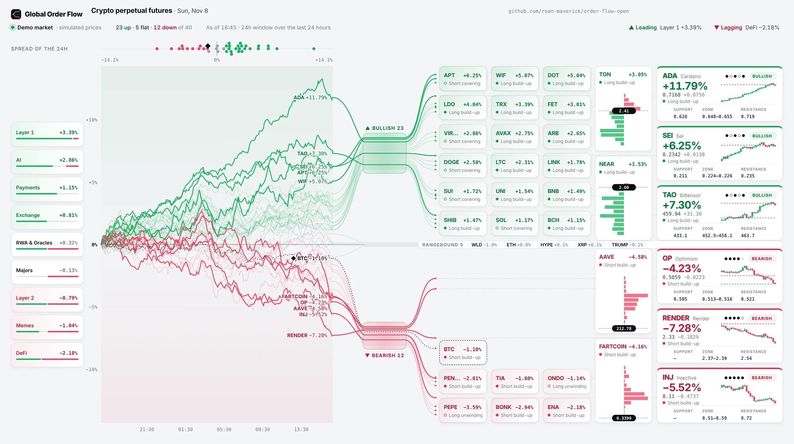
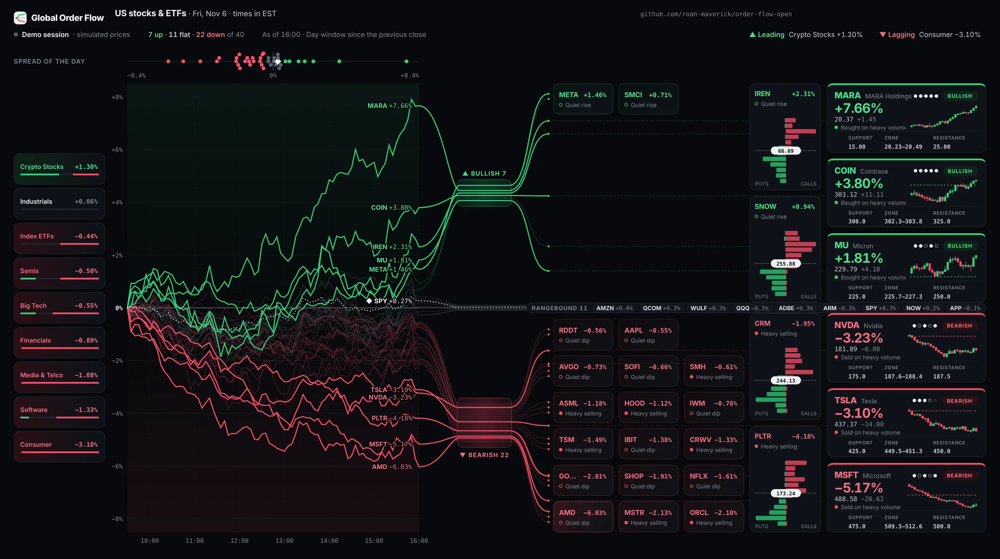

<div align="center">


# Global Order Flow

### See where the world's money is flowing, live.

The most-traded **crypto perpetuals** and **US stocks** on one board.<br>
Bulls rise above the zero line, bears fall below it, and every name runs on its own path to a card.

**Free · open source (MIT) · no keys · no sign-up**

[Run it yourself](#run-it-yourself) · [How to read it](#reading-the-board) · [Data](#where-the-data-comes-from)

</div>

<br>



<table>
  <tr>
    <td width="68%"></td>
    <td width="32%"></td>
  </tr>
</table>

<sub>Screenshots show the built-in demo market. When you run it, the crypto board reads the exchanges in real time and the US board uses the file you build with `npm run data:us`.</sub>

## Why

A heatmap shows you a colour. An option chain shows you one stock. **This shows you the whole market moving at once, and why each name stands where it does.**

- **Two boards, one switch.** *Crypto Perps*: the most-traded USDT perpetuals of the moment, picked live by 24h volume. *US Stocks*: the names traders actually trade (top options volume: SPY, QQQ, NVDA, TSLA, AAPL, MU, AMD, META, PLTR, MSTR…) plus the index ETFs.
- **Positioning, not just price.** For crypto, price is read against perpetual **open interest**: long build-up, short covering, short build-up, long unwinding. For US stocks, which have no single-stock futures, price is read against **relative volume**: is the move happening on more or less volume than usual for this time of day?
- **Levels that mean something.** Support and resistance come from the heaviest **option open interest** (put wall below, call wall above) for US stocks, BTC and ETH, and from **volume shelves** for every other coin.
- **A reason for every rank.** Click any name for 5-minute candles, its levels, the zone where positions were added, and five checks of conviction in plain words.
- **Made to be shared.** One click on **Save image** downloads a crisp PNG of the board, ready for X, Instagram or Discord.

## Run it yourself

```bash
git clone https://github.com/roan-maverick/order-flow-open.git
cd order-flow-open
npm install
npm run dev            # http://127.0.0.1:5199
```

Requires Node 20 or newer. The crypto board goes live straight away. The US board shows a demo session until you build its data file:

```bash
npm run data:us        # writes public/data/us.json (Yahoo Finance bars + Cboe options)
```

| Want | Do |
|---|---|
| The live board on your machine | `npm run dev` |
| Real US data locally | `npm run data:us`, then refresh the page |
| The demo market (offline, always moving) | add `?demo` to the URL |
| A production build | `npm run build` → `dist/` (any static host) |
| Tests | `npm test` |

No server and no keys: crypto is read live in your browser, and the US file is a local JSON file you rebuild whenever you want fresh data.

## Reading the board

| Part | What it shows |
|---|---|
| **Status line** | The source (`Binance perps`, `US stocks · delayed`, `Demo market`), how the board splits (`22 up · 5 flat · 13 down of 40`), the time, and the leading and lagging sectors. |
| **Spread strip** | Every name as a dot, placed by its move: the shape of the day at a glance. The benchmark (BTC or SPY) is the diamond. |
| **Chart** | Each name's move through the window, from 0%. Bold lines are the five biggest movers each side; the dotted line is the benchmark. |
| **Sectors** | Each sector's median move, leader on top. The bar under each is its up / flat / down split. Hover one to light its names. |
| **Tunnels** | Every bullish line squeezes through the green tunnel, every bearish one through the red, then fans out to its tile. |
| **The bar** | The zero line carried across. Names that moved less than the window's threshold end here as *rangebound*. |
| **Tiles** | One per name, ranked by the move. The colour deepens with the size of the move. A filled dot means new positions or heavy volume behind it; a hollow dot means positions closing or a quiet move. |
| **Tall tiles** | The next-strongest readings, with open interest (or traded volume) by price around spot. |
| **Big cards** | The strongest readings each side in full: the move, build-up, conviction dots, support, zone and resistance, with candles. |
| **Hover / click** | Hover anything to light its path; click for the full reading. |

**Windows.** Crypto: 24h, 4h, 1h. US: the day (since the previous close), the last hour, the last 15 minutes. **Universe.** Crypto: top 40 or top 80 perps by volume. US: top 40 or all 70 names.

### Build-up

| Crypto (price + open interest) | | US stocks (price + relative volume) | |
|---|---|---|---|
| Price ↑ OI ↑ | **Long build-up** | Price ↑ on heavy volume | **Heavy buying** |
| Price ↑ OI ↓ | **Short covering** | Price ↑ on light volume | **Quiet rise** |
| Price ↓ OI ↑ | **Short build-up** | Price ↓ on heavy volume | **Heavy selling** |
| Price ↓ OI ↓ | **Long unwinding** | Price ↓ on light volume | **Quiet dip** |

### The five checks of conviction

1. **Participation moved with price.** New positions were opened (crypto), or volume ran above its usual pace (US).
2. **The shorter window agrees.** For example, the last hour points the same way as the day.
3. **Aggressors lead** (crypto: taker buys vs sells) or **options traders lean the same way** (US: call/put volume against the board's median).
4. **The benchmark agrees.** BTC or SPY moved the same way.
5. **The sector agrees.** Its sector's median leans the same way.

Each card's dots show which hold (filled), which fail (hollow) and which can't be measured.

## Where the data comes from

| Board | Source | Refresh |
|---|---|---|
| Crypto | [Binance USDⓈ-M futures](https://developers.binance.com/docs/derivatives/usds-margined-futures/general-info) public API: 5-minute klines with taker volume, 5-minute open-interest history, funding. Falls back to [Bybit](https://bybit-exchange.github.io/docs/v5/intro) where Binance is blocked. | Every minute, in the visitor's browser |
| Crypto levels | [Deribit](https://docs.deribit.com/) option open interest for BTC and ETH (expiries in the next 35 days) | On load |
| US stocks | Yahoo Finance 5-minute bars; Cboe delayed option quotes (open interest by strike, call/put volume) Whenever you run `npm run data:us` |

If no live source answers (offline, or a network that blocks the exchanges), the board says so and shows the built-in **demo market**: a deterministic simulation with a market mood, sector moods and positioning that mostly agrees with the move. Demo prices are not quotes.

Data is delayed where noted and provided for information only. Check each provider's terms before using it beyond personal, informational use.

## Make it yours

- **Name, author, links:** `src/config.ts`
- **Colours:** `src/ui/palette.ts` (light and dark)
- **Which US names, and their sectors:** `src/data/universe.ts`
- **Thresholds, checks, strength weights:** `src/model/flow.ts`
- **Layout of the board:** `src/ui/geometry.ts`

```
src/
  data/       crypto.ts (Binance/Bybit/Deribit) · us.ts · demo.ts · universe.ts
  model/      flow.ts: sides, build-up, checks, levels, zones, sectors
  ui/         Board (chart, tunnels, tiles, cards) · Detail · MobileBoard · geometry · palette
scripts/      build-us-data.mjs: the US market file
```

## Credits

The board concept (bulls above zero, bears below, tunnels to cards) is inspired by [Order Flow](https://github.com/MrChartist/order-flow) by Mr. Chartist, built for Indian F&O. This is an independent implementation for global markets, written from scratch.

**Readings, not investment advice.**

## License

[MIT](LICENSE)
